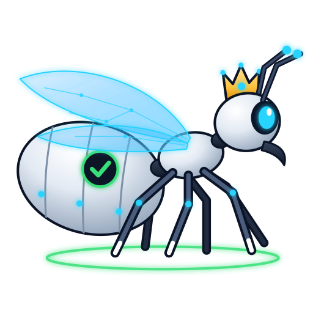
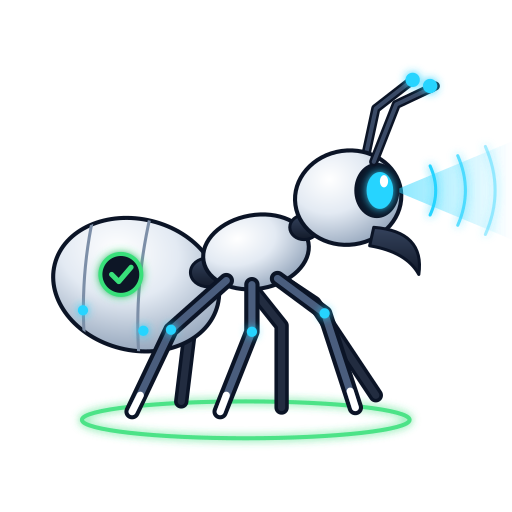
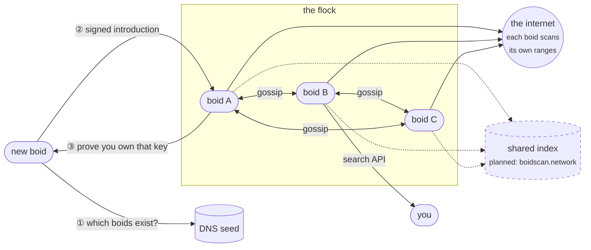

# Boidscan

A free and open source index of publicly reachable services, in the spirit of Shodan and Censys, run by its community instead of a company.

Knowing what is exposed on the internet should not depend on a commercial subscription. Boidscan aims to build that index as a shared public resource: anyone can run a node, anyone can query the results, and everyone can see who is scanning.

## Why "boids"

The name comes from [Boids](https://en.wikipedia.org/wiki/Boids), Craig Reynolds' 1986 flocking simulation, where many simple agents following a few local rules behave like one flock. Boidscan nodes ("boids") work the same way: independent nodes, run by different people, each following the same rules, that together cover more than any single one could.

## How the flock fits together

Each boid scans the ranges its operator picks, records what services announce during a normal handshake (banners, HTTP responses, TLS certificates) and publishes the results through a public API. Boids find each other through seeds, prove who they are with a signing key, and keep track of each other by gossip.

Solid lines work today. The dashed part is the next milestone: boids splitting up scan work and sharing results, so the flock builds one index instead of many separate ones. That index will be searchable in the browser at boidscan.network.

## Scanning in the open

Boidscan never tries credentials, never exploits vulnerabilities and never hides who is scanning. Every boid enforces the same rules:

- **Identity.** A boid refuses to scan without an abuse contact. The contact is sent with every request and shown on the boid's public info page.
- **Rate ceiling.** 10,000 packets per second at most.
- **Exclusions.** IANA reserved ranges are always excluded. Operators can exclude more on their own boid.
- **One block list.** Every boid publishes the scanning addresses of itself and every boid it has verified. A network that does not want to be scanned blocks that list in its firewall.

## Get involved

- [boidscan/boidscan](https://github.com/boidscan/boidscan): the node, search API and Go client. It includes a lab that runs a three-boid flock on a private Docker network, so you can watch boids find each other without scanning anything real.

## License

[AGPL-3.0](https://github.com/boidscan/boidscan/blob/main/LICENSE).
